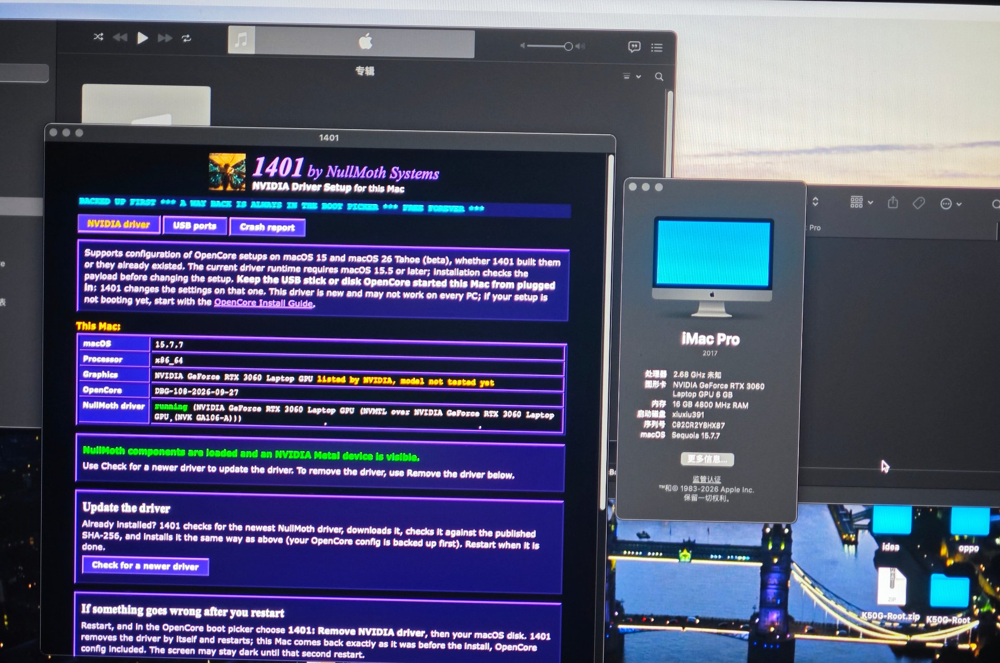

# ROG Zephyrus M16 (GU603ZM) OpenCore EFI — macOS Sequoia 15 × NVIDIA

<p align="center">
  <a href="https://github.com/pubglite55/ROG-GU603ZM-Hackintosh/stargazers"></a>
  <a href="https://github.com/pubglite55/ROG-GU603ZM-Hackintosh/commits/master"></a>
  <a href="https://github.com/pubglite55/ROG-GU603ZM-Hackintosh/blob/master/LICENSE"></a>
</p>

**English** | [简体中文](README.zh-CN.md)

> [📦 Download latest EFI](https://github.com/pubglite55/ROG-GU603ZM-Hackintosh/releases/latest) · [Install guide](INSTALL.md) · [Changelog](CHANGELOG.md) · [Contributing](CONTRIBUTING.md)
>
> Updated: 2026-10-10 ｜ OpenCore 1.0.8 ｜ Target OS: **macOS Sequoia 15.x**
> Built following the Dortania OpenCore-Install-Guide and sqlsec/Hackintosh conventions.
> dGPU solution is based on [nullmoth/nvidia-macos-driver](https://github.com/nullmoth/nvidia-macos-driver) (a community NVIDIA driver for macOS 15 only).

---

## ⚠️ Read Before Use: Three Prerequisites + One Security Note

1. **Target must be macOS 15 (Sequoia) only** — the nullmoth driver supports 15.x (verified on 15.7/15.8). Do not attempt Sonoma / 26.
2. **BIOS / GPU mode**: in Windows, use Armoury Crate to switch GPU mode to **Ultimate (MUX dGPU direct)**, disabling iGPU output — this machine's Iris Xe has no macOS driver; only by wiring the internal panel/HDMI directly to the RTX 3060 is there any display.
3. **Do not mix with the old EFI**: this machine was previously booted by a RapidEFI-style EFI (injecting 14 SSDTs + `XSTA/XCRS/XOSI` renames). This repo's ACPI was regenerated against the **restored stock tables** — replace the whole EFI, do not layer old config on top.
4. **⚠️ SMBIOS triplets are redacted**: in this repo's `config.plist`, Serial/MLB/UUID/ROM are placeholders (`CHANGEME-*` / zero UUID / `00:11:22:33:44:55`). **You MUST generate your own triplets with GenSMBIOS before use**, otherwise iCloud/iMessage won't work and sharing the same triplets across many machines will get the serial banned by Apple.

---

## 1. Hardware Support Matrix

| Component | Model / ID | Status | Notes |
|---|---|---|---|
| CPU | i7-12700H (Alder Lake-H) | ✅ | SSDT-PLUG-ALT + `ProvideCurrentCpuInfo`; model name corrected to i7-12700H |
| iGPU | Iris Xe 8086-46A6 | ❌ | Apple never supported 11th-gen+ Intel iGPU — no solution (not used for output) |
| dGPU | RTX 3060 Laptop 10DE-2520 (GA106M) | ✅ **verified** | nullmoth driver, Metal 3, internal 2560×1600@165Hz + external HDMI |
| Internal panel | AUO 2560×1600 165Hz | ✅ | wired to dGPU via MUX, lit by nullmoth |
| HDMI 2.0b | direct to dGPU | ✅ | same as above |
| USB-C(DP)/TB4 | 8086-461E | ❌/⚠️ | TB/USB4 controller unsupported on macOS; use USB-A ports for the installer |
| Audio | Realtek ALC285 10EC-0285 | ⚠️ tuning | codec correctly detected, speaker pin-map layout needs rotation (see §3.1) |
| Ethernet | Realtek RTL8125 2.5GbE | ✅ | LucyRTL8125Ethernet, no config |
| Wi-Fi | Intel AX211 (8086-51F0) | ⚠️ | itlwm.kext + [HeliPort.app](https://github.com/OpenIntelWireless/HeliPort/releases) (no AirportItlwm for Sequoia) |
| Bluetooth | Intel AX211 (8087-0033) | ⚠️ | IntelBluetoothFirmware + IntelBTPatcher + BlueToolFixup |
| Keyboard | ATK PS/2 (ATK3001) | ✅ | VoodooPS2Controller |
| Trackpad | ELAN1010 @ I2C1 (8086-51E9) | ⚠️ to verify | Alder Lake I2C ID + GPIO dependency patched, see §3.6 |
| SD reader | Genesys GL9755 | ❌ | no macOS driver |
| Camera | UVC (13D3-56EB) | ✅ | works out of box |

---

## 2. NVIDIA dGPU Solution (core)

### 2.0 Proof it works

The 1401 driver installer reporting **"NullMoth components are loaded and an NVIDIA Metal device is visible"** on this machine (RTX 3060 Laptop, macOS 15.7.7):



### 2.1 The nullmoth driver

[nullmoth/nvidia-macos-driver](https://github.com/nullmoth/nvidia-macos-driver) is a community open-source driver released 2026-10-08:

- Architecture: `Metal app → NVMTLDriver.bundle (Apple AIR→SPIR-V translation) → NVK (Mesa Vulkan + NAK) → NVRM/NVAccel/NVRMFB/NVRMAGDC → GSP firmware (610.57.04) → GPU`
- Device table covers Turing / Ampere / Ada / Blackwell (GTX 16, RTX 20/30/40/50, including laptop GPUs).
- **This machine's RTX 3060 Laptop (GA106M) is in the table, and has been verified to light up in this project** (Metal 3).

### 2.2 Key principle: do NOT disable the dGPU

| Item | Action |
|---|---|
| `-wegnoegpu` / `nv_disable=1` | ❌ disabled (would turn off the only usable GPU) |
| WhateverGreen | ❌ removed (its NVIDIA handling conflicts with this driver) |
| GPU mode Ultimate | ✅ required |
| nullmoth boot-args | ✅ preset `nvfb=1 nvaccel=1 nvfbheads=4 -nvkmsnosmooth amfi_get_out_of_my_way=0x1 amfi=0x80` |
| Laptop-required arg | ✅ `-nvrmnoflip` (internal panel won't light without it) |

### 2.3 Verified findings (this project)

- **Do NOT add `-v`**: verbose starves the driver's auto-go thread, exceeding the `settle+40s` cap, after which the driver gives up lighting the display (see `调试-config/` and discussion history).
- Use the officially recommended BAR pair: `UEFI ResizeGpuBars=13` + `Booter ResizeAppleGpuBars=-1` (the driver expands BAR1 to 8GB itself).
- First boot stalling at `[ PCI configuration begin ]` is a normal wait point; allow up to ~3 minutes.
- Post-install boot log keywords: `NVRM-xnu: PASS 2 REACHED` / `nvrm-boot-hold = "display armed"`.

### 2.4 Why not OCLP

- OCLP's NVIDIA support only goes up to Kepler/Maxwell/Pascal (max Ventura); **Ampere (RTX 30-series) has no OCLP solution**.
- nullmoth does not depend on OCLP: kexts install to `/Library/Extensions` + `kmutil` rebuild of AuxKC, requiring only `csr-active-config=430A0000` + `SecureBootModel=Disabled` (both preset).

---

## 2.5 Boot picker theme

This EFI ships the **GoldenGate graphical theme** (OpenCanopy + `Resources/`). To switch back to the plain text picker:
- remove `EFI/OC/Drivers/OpenCanopy.efi`;
- set `Misc → Boot → PickerMode` back to `Builtin`.
Other themes (Chardonnay/Syrah are already in `Resources/Image/Acidanthera/`) can be selected via `PickerVariant`.

---

## 3. Other Driver Notes

### 3.1 Audio (ALC285, tuning)
- AppleALC injects `layout-id` to `PciRoot(0x0)/Pci(0x1F,0x3)`.
- The codec is correctly detected (`IOHDACodecVendorID=0x10EC0285`), but layout 21 has a wrong pin-map on this machine (falls back to generic).
- **Suggested rotation order**: `11 → 88 → 31 → 71 → 33 → 52 → 61 → 66` (`调试-config/声卡-layoutNN.plist` ready; swap one at a time and reboot).
- SSDT-HPET + two HPET rename patches are in place (required for audio IRQ).

### 3.2 Ethernet
- RTL8125 2.5GbE → LucyRTL8125Ethernet.kext, no config.

### 3.3 Wi-Fi
- No AirportItlwm for Sequoia → use **itlwm.kext + [HeliPort.app](https://github.com/OpenIntelWireless/HeliPort/releases)** (direct download: https://github.com/OpenIntelWireless/HeliPort/releases/latest/download/HeliPort.dmg). Trade-off: no native Wi-Fi menu icon, no AirDrop/Handoff.

### 3.4 Bluetooth
- IntelBluetoothFirmware + IntelBTPatcher + BlueToolFixup. When mapping USB ports, keep the Bluetooth port (HS10, type Internal/255).

### 3.5 USB
- XHCI (8086-51ED) is not in Apple's native table → `XHCI-unsupported.kext` (daliansky build) included.
- Port mapping not done yet; use USB-A for first install, then generate UTBMap.kext with USBToolBox.

### 3.6 Trackpad (ELAN1010, patched, to verify)
- The ELAN1010 trackpad lives at `_SB.PC00.I2C1.ETPD` (`_CID=PNP0C50`), I2C controller 8086-51E9 (Alder Lake), GPIO controller INTC1055.
- Upstream VoodooI2C 2.9.1's match table **does not include Alder Lake**; this project applies two fixes:
  1. Appends `51E8/51E9/51EA/51EB/51C8` to `VoodooI2CPCIController.IOPCIMatch` in `VoodooI2C.kext/Contents/Info.plist`;
  2. Adds VoodooI2C's 3 internal PlugIns (`VoodooGPIO` / `VoodooI2CServices` / `VoodooInput`) as separate config entries (upstream omission causes the main kext's dependency resolution to fail, so nothing loads).
- `SSDT-GPI0.aml` (a RapidEFI leftover referencing nonexistent `_SB.GPI0.XSTA`) has been **removed** — the native GPI0 `_STA` already returns enabled on macOS.

---

## 4. EFI Directory Structure

```
EFI-GU603ZM-Sequoia-OC1.0.8/
├─ EFI/
│  ├─ BOOT/BOOTx64.efi                 # OpenCore boot entry
│  └─ OC/
│     ├─ OpenCore.efi                  # OpenCore 1.0.8
│     ├─ config.plist                  # ★ active config (install + post-install)
│     ├─ ACPI/                          # SSDTs + stock table replacement (see §5)
│     ├─ Drivers/                       # OpenRuntime / OpenHfsPlus / ResetNvramEntry / OpenCanopy
│     ├─ Kexts/                         # 21 kexts (see §7)
│     ├─ Resources/                     # GoldenGate theme + fonts + labels
│     └─ Tools/
├─ 参考资料/                            # SSDT sources / SSDTTime patches / version records
└─ 调试-config/                         # backup / rescue / audio layout variants (see that dir)
```

> Note: `工具/` (HeliPort.dmg, USBToolBox-Windows.zip, macrecovery) is not in the repo (size/licensing). Get from upstream:
> - HeliPort: https://github.com/OpenIntelWireless/HeliPort/releases
> - USBToolBox: https://github.com/USBToolBox/tool/releases
> - macrecovery: https://github.com/acidanthera/OpenCorePkg (`Utilities/macrecovery`)

---

## 5. ACPI Plan

### 5.1 SSDTs (generated by SSDTTime)
| SSDT | Purpose |
|---|---|
| SSDT-EC | fake EC (does not disturb real EC0_) |
| SSDT-USBX | USB power properties |
| SSDT-PLUG-ALT | CPU power management plugin-type=1 |
| SSDT-RTCAWAC | AWAC→RTC switch |
| SSDT-HPET | HPET `_CRS/_STA` rebuild (audio IRQ required) |
| SSDT-XOSI | pairs with `_OSI→XOSI` |

Also **DSDT.aml** (full replacement, fixes Alder Lake conditional USB port declarations that otherwise fail DSDT load) and **APIC.aml** (MADT 14-core alignment).

### 5.2 ACPI patches (three, paired with SSDTs)
`HPET _STA→XSTA`, `HPET _CRS→XCRS`, `_OSI→XOSI`.

> ⚠️ The three patches and their SSDTs are paired dependencies — enable/disable as a group, never split.

---

## 6. config.plist Key Items

### 6.1 Booter / Kernel key quirks
- `AppleXcpmCfgLock=true` (ROG BIOS has no CFG Lock toggle)
- `ProvideCurrentCpuInfo=true` (required for Alder Lake hybrid cores)
- `DisableIoMapper=true` (VT-d fallback)
- `AvoidRuntimeDefrag` / `RebuildAppleMemoryMap` / `SyncRuntimePermissions` etc.
- `Kernel → Block: IONDRVSupport (Exclude)`: enable after driver install (prevents firmware framebuffer from taking display 0)

### 6.2 NVRAM / boot-args
| Key | Value |
|---|---|
| boot-args | `keepsyms=1 debug=0x100 nvfb=1 nvaccel=1 nvfbheads=4 -nvkmsnosmooth amfi_get_out_of_my_way=0x1 amfi=0x80 revcpu=1 revpatch=cpuname,memtab revcpuname=i7-12700H -vi2c-force-polling -wegnoigpu -nvrmnoflip` |
| csr-active-config | `430A0000` |
| prev-lang:kbd | `zh-Hans:252` |

> Note: `revcpu/revpatch/revcpuname` are also written under NVRAM `4D1FDA02-...` GUID (RestrictEvents' real read location); `-wegnoigpu` hides the driverless Iris Xe.

### 6.3 SMBIOS (MacBookPro16,1)
- Model: `MacBookPro16,1` (16-inch 2019, dGPU model, fits this plan)
- **Triplets are redacted to placeholders** — generate and replace with GenSMBIOS before use (Serial / MLB / SystemUUID / ROM).

### 6.4 About Windows dual-boot
- OpenCore's ACPI injection is global (the modified DSDT/APIC are handed to Windows too, causing `ACPI_BIOS_ERROR 0xA5`).
- This EFI sets `ScanPolicy=0xF0103`, so the OC menu **does not show a Windows entry**.
- **To boot Windows, use the BIOS F8 boot menu and pick "Windows Boot Manager"** (gets the stock clean ACPI, boots normally).

---

## 7. Version List

| Component | Version |
|---|---|
| OpenCore | 1.0.8 |
| Lilu | 1.7.2 |
| VirtualSMC / SMCProcessor / SMCBatteryManager | 1.3.8 |
| AppleALC | 1.9.8 |
| RestrictEvents | 1.1.6 |
| NVMeFix | 1.1.3 |
| BlueToolFixup | 2.7.2 |
| IntelBluetoothFirmware / IntelBTPatcher | v2.4.0 |
| itlwm | v2.3.0 |
| LucyRTL8125Ethernet | 1.2.300 |
| ECEnabler | 1.0.6 |
| VoodooPS2Controller | 2.3.7 |
| VoodooI2C / VoodooI2CHID | 2.9.1 (with this project's Alder Lake ID patch) |
| USBToolBox | 1.2.0 |
| XHCI-unsupported | daliansky build |

---

## 8. Installation & Verification

1. BIOS: enable Above 4G Decoding / Resizable BAR, disable VT-d (optional), disable Secure Boot, GPU mode Ultimate.
2. Generate triplets to replace placeholders → write to disk → boot from a USB-A port.
3. Detailed install steps, BIOS settings, and troubleshooting: see **[INSTALL.md](INSTALL.md)**.
4. Both configs pass ocvalidate 1.0.8 (0 errors).

---

## 9. Credits

Dortania OpenCore-Install-Guide, sqlsec/Hackintosh, Acidanthera, CorpNewt (SSDTTime), OpenIntelWireless, nullmoth (driver/1401), daliansky, Mieze, VoodooI2C, and other community projects.

## 10. License

The EFI config files and docs in this project are released under the **MIT License** (see `LICENSE`). Individual Kexts / drivers / SSDTs remain the property of their respective authors and follow their original licenses.
